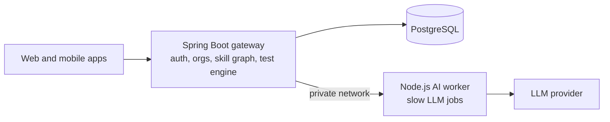

 

---

## ✨ Who we are

We are a team of 12 students from **Lakshmi Narain College of Technology, Bhopal**, building for the **EPAM CoE programme**. We like problems where good engineering meets real learners.

## 🚀 What we are building

### AI Career & Skill Roadmap Platform

Most learners choose what to study by guesswork. We replace the guesswork with three steps:

<table>
  <tr>
    <td align="center" width="33%">
      <h3>📏 Measure</h3>
      A short adaptive test finds your real level in a chosen track, in fewer than 10 questions.
    </td>
    <td align="center" width="33%">
      <h3>🧭 Plan</h3>
      An AI model turns your result and the track's skill graph into an ordered learning roadmap.
    </td>
    <td align="center" width="33%">
      <h3>📈 Track</h3>
      Follow the roadmap, mark progress, and re-test to see how far you have come.
    </td>
  </tr>
</table>

Architecture designed by Dev Sharma, technical and design lead.

### 🏗️ How it fits together

The gateway is the only service the apps talk to. The AI worker does the slow work in the background and returns validated JSON.

## 🗺️ Roadmap

| Stage | What it covers | Status |
|---|---|---|
| **Sprint 1** | Backend skill graph and adaptive diagnostic test | 🚧 In progress |

## 🧰 Tech we use

  
  
  
  
  
  

## 🔝 Top repository

  

> **upskill-platform** is where the gateway, AI worker, web app, mobile app and docs live. Start here.

## 📦 Repositories

| Repository | What it is |
|---|---|
| [`upskill-platform`](https://github.com/LNCT-Unix/AI-Powered-Upskilling-Platform) | The main project: gateway, AI worker, web app, mobile app and docs |
| More coming | New repositories will be listed here as the team creates them |

## 🏆 Top contributors

The wall below updates automatically from commit history of our main repository.

### ⭐ Core contributors

<table>
  <tr>
    <td align="center" valign="top" width="20%">
      <a href="https://github.com/dev47929">
         
        <strong>Dev Sharma</strong>
      </a>
        
      <strong>Technical &amp; Design Lead</strong>
        
      Architecture, Gateway Backend, Diagnostic Engine &amp; Database Design
    </td>
    <td align="center" valign="top" width="20%">
      <a href="https://github.com/mahakshri">
         
        <strong>Mahak Shrivastava</strong>
      </a>
        
      System Flow Design &amp; LLM Fine-Tuning
    </td>
    <td align="center" valign="top" width="20%">
      <em>Add a teammate</em>
        
      Name, GitHub profile &amp; area of focus
    </td>
    <td align="center" valign="top" width="20%">
      <em>Add a teammate</em>
        
      Name, GitHub profile &amp; area of focus
    </td>
    <td align="center" valign="top" width="20%">
      <em>Add a teammate</em>
        
      Name, GitHub profile &amp; area of focus
    </td>
  </tr>
</table>

## 🤝 Contributing

We welcome fixes and ideas from teammates and mentors.

1. Read the README of the repository you want to work on.
2. Create a branch from `main`: `feature/<short-name>`.
3. Keep each pull request focused on one change.
4. Ask for at least one review before merging.

Found a problem or have an idea? Open an issue in the repository it relates to.

## 📬 Get in touch

- Issues and ideas: open an issue in the relevant repository
- Email: _add a team contact address_

Team Unix · Lakshmi Narain College of Technology, Bhopal · This profile is maintained by Dev Sharma, technical and design lead

